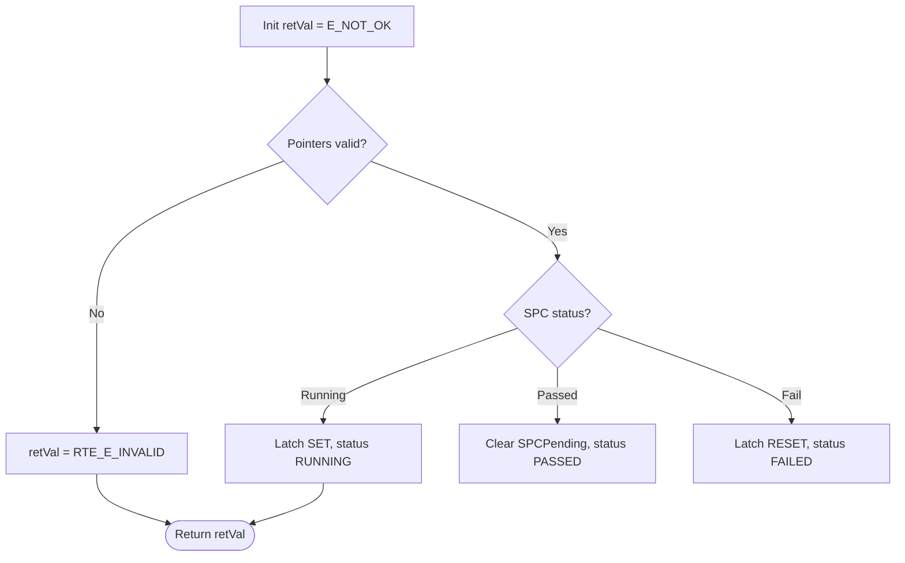

# Rhapsody FlowGen — USER GUIDE (Opus v4)

Turn Mermaid `.mmd` flowcharts into IBM Rhapsody 109 **Activity Diagrams** with
filled action text, positioned nodes, cleanly‑spread connectors, and
**[YES]/[NO]** guards on decision branches.

The tool is **hybrid**:

1. **COM** (Rhapsody automation) builds the model + all control‑flow edges.
2. **SBSX post‑process** writes what COM can’t on this Rhapsody build — action
   **body text**, node **positions**, connector **anchors** (no overlaps) and
   **guards** — by editing the saved diagram unit as **raw text** (RPY‑ASCII
   safe: dry‑run by default, always makes a `.bak`).

---

## 1. Install

**Prerequisites**
- Windows + IBM Rhapsody (the COM step needs it; `pip` package `pywin32`).
- Python 3.9+ (32‑bit is fine — matches a 32‑bit Rhapsody).

```bat
python -m pip install --upgrade pip
pip install lxml pyyaml pywin32
```

Verify (no Rhapsody needed):
```bat
cd <package>            REM folder that contains rhapsody_flowgen\
set PYTHONPATH=.
python -m rhapsody_flowgen.test_flow_fixes      REM 6/6 PASS
python -m rhapsody_flowgen.test_hybrid_updates  REM PASS
```

---

## 2. Configure — `rhapsody_flowgen/config.yaml`

Edit the paths/names at the top. There are **two modes**, and the same file
supports both:

- **Single diagram** → uses the top‑level `class` / `operation` / `mermaid_file`.
- **Multiple diagrams** → uses the `diagrams:` list (each entry = one AD).

```yaml
project_path: "D:\\...\\FlashBootloader_SwDD.rpyx"
package_path: ["50_DetailedDesign", "50_CMP_Implementation"]   # base package

# (A) single-diagram keys (main.py)
class: "ADCMonMain"
operation: "AdcAbs_Get_VBATT_MON"
mermaid_file: "flowinitializesensor.mmd"

# (B) multi-diagram list (run_all.bat)
diagrams:
  - class: "ADCMonMain"
    operation: "AdcAbs_Get_VBATT_MON"
    mermaid_file: "flows/AdcAbs_Get_VBATT_MON.mmd"
  - class: "ADCMonMain"
    operation: "AdcAbs_GetGroup0ConversionStatus"
    mermaid_file: "flows/AdcAbs_GetGroup0ConversionStatus.mmd"
    # package_path: [...]      # optional per-diagram override
    # diagram: "AD_..."        # optional AD-name override (default AD_<operation>)
```

> **Yes — one YAML can drive many diagrams across many units/classes.** Put each
> `.mmd` under `rhapsody_flowgen/flows/` (or give an absolute path), point each
> entry at its operation/class, and the batch tools do the rest.

---

## 3. Run — SINGLE diagram

```bat
REM 1) COM build (writes rhapsody_flowgen\sbsx_plan.json)
python -m rhapsody_flowgen.main

REM 2) Close the Rhapsody PROJECT, then patch the saved unit:
run_sbsx_patch.bat
```
`run_sbsx_patch.bat` runs **locate → inspect → dry‑run → (confirm) → write**.
Expected: actions `body=ok pos=ok`, diamonds `body=n/a pos=ok`, `guards set N`,
then `WROTE … .bak`.

Manual equivalent:
```bat
python -m rhapsody_flowgen.sbsx_patch_v109 locate  --root "<..._rpy>" --diagram AD_<Op>
python -m rhapsody_flowgen.sbsx_patch_v109 inspect --sbsx "<unit>.sbsx" --diagram AD_<Op>
python -m rhapsody_flowgen.sbsx_patch_v109 patch   --sbsx "<unit>.sbsx" --diagram AD_<Op> --plan rhapsody_flowgen\sbsx_plan.json
python -m rhapsody_flowgen.sbsx_patch_v109 patch   --sbsx "<unit>.sbsx" --diagram AD_<Op> --plan rhapsody_flowgen\sbsx_plan.json --write
```

---

## 4. Run — MANY diagrams at once

```bat
run_all.bat
```
It: (1) COM‑builds every diagram in `diagrams:` and saves a per‑diagram plan to
`rhapsody_flowgen\plans\AD_<op>.json`; then (2) after you close the project,
**patches all of them** — grouping by unit so each `.sbsx` is written **once**
(one `.bak` per unit).

Manual equivalent:
```bat
python -m rhapsody_flowgen.batch_main --config rhapsody_flowgen\config.yaml   REM COM build all
REM (close the project in Rhapsody)
python -m rhapsody_flowgen.patch_all  --config rhapsody_flowgen\config.yaml            REM dry-run all
python -m rhapsody_flowgen.patch_all  --config rhapsody_flowgen\config.yaml --write    REM apply all
```

What you’ll see per diagram:
```
[AD_OpA] -- matched 17/17 plan nodes by position --
[AD_OpA] -- routed 22/22 edges (anchor-spread, no waypoints) --
[AD_OpA] -- guards set on 11 edges --
WROTE <unit>.sbsx (backup <unit>.sbsx.bak)
```

---

## 5. Writing the `.mmd`

Standard Mermaid `flowchart TD`:

- `[...]` = **action** (rectangle). `{...}` = **decision** (diamond).
- Edge labels (`-- Yes -->`, `-- No -->`, `-- Running -->`) become **guards**.
  `Yes/No` normalize to `YES/NO`; other labels are kept verbatim.

---

## 6. Safety & good habits
- **Close the Rhapsody project** before patching (the app may stay open).
- The patcher is **dry‑run by default**; `--write` makes a byte‑exact `.bak`
  first. To revert: `copy /Y "<unit>.sbsx.bak" "<unit>.sbsx"`.
- Never hand‑edit the `.sbsx` while Rhapsody has the project open.

---

## 7. Troubleshooting

| Symptom | Cause / Fix |
|---|---|
| `ImportError: cannot import name 'etree' from 'lxml'` | Broken lxml. `pip install --force-reinstall --no-cache-dir lxml` |
| `scoped … : 0` in `inspect` | The diagram’s graphics are in **another** unit. Use `locate` (or `run_all` does it automatically) and patch the file it flags. |
| `NameError: _guard_text` on `patch` | You’re on an old patcher. Use the Opus v4 `sbsx_patch_v109.py` (guards defined before `__main__`). |
| Rhapsody says *“not in RPY‑ASCII format”* | An external tool re‑serialized the XML. This package never does; restore the `.bak` and re‑run. |
| Boxes still empty after patch | Body is set on the model `IState/_entryAction/_body`. Confirm `inspect` shows the nodes with `body=None` **before** patch; if the diagram lives in another unit, `locate` first. |
| `guards set on 0` | The edges have **no labels** in the `.mmd`, or endpoints didn’t match by position. Add `-- Yes/No -->` labels. |
| Different Rhapsody version | Schema is pinned to **109.0.1**. Run `inspect`; if node counts look wrong, the tag names may need re‑pinning (see the Developer Guide). |

---

## 8. What’s automated vs manual
**Automated:** node text, positions, connector anchor spreading (fewer
overlaps), and `[YES]/[NO]`/branch‑label guards — for one or many diagrams.

**Still manual (optional polish):** true right‑angle “elbow” connector routing.
Rhapsody auto‑routes from the anchors we set (even hand‑made diagrams store no
waypoints), so this is cosmetic. See the Developer Guide → *Future work* for how
to add an `--elbow` mode from a one‑time reference.
